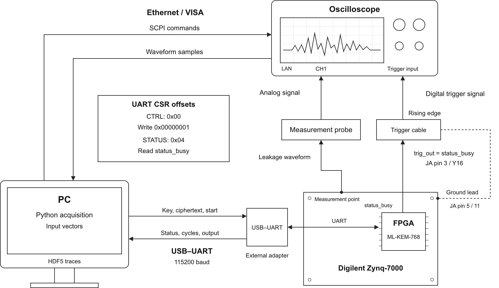

# ML-KEM-Testkit

ML-KEM-768（FIPS 203）的 FPGA 硬件核心，以及围绕它的测试与侧信道评估工具链：

- NIST ACVP 功能测试，可在板上（UART）或 RTL 仿真中运行；
- 可复现的测试向量；
- 示波器 trace 采集；
- CPA / TVLA 分析；
- 一个本地 Web GUI，把以上步骤串起来。



## 目录结构

```
hdl/core/               厂商无关的 SystemVerilog：ML-KEM-768 核心、AXI-Lite CSR、UART 协议桥、axil_cdc
hdl/xilinx/arty_a7/     Arty A7-35T/100T 顶层与约束（板载 USB 串口）
hdl/xilinx/arty_z7/     Arty Z7-20 纯 PL 版（外接 3.3 V USB-UART 到 Pmod JA）
hdl/xilinx/arty_z7_ps/  Arty Z7-20 PS 版（板载 USB 串口经 PS 转发到 PL）
hdl/xilinx/sakura_x/    SAKURA-X（SASEBO-GIII）Kintex-7 顶层与约束（板载 USB 经 Spartan-6 local bus）
sw/arty_z7_uart_fwd/    Z7 PS 上运行的裸机 UART 字节转发程序
cpa_toolkit/            Python 主机端：UART 驱动、FIPS 203 参考实现、测试向量、采集、CPA/TVLA、Web GUI
scripts/vivado/         Vivado 构建 / 烧写 Tcl
scripts/ise/            SAKURA-X Spartan-6 控制器构建（ISE 14.7）
scripts/board/          板卡启动、SAKURA-X 双 FPGA 烧录及链路检查
scripts/test/           ACVP 测试（板上 / Verilator）
scripts/gen/            微码与 zeta ROM 生成器
testbench/              Icarus / Verilator / cocotb 测试平台
tests/                  Python 单元测试；tests/acvp/ 为 NIST ACVP 向量
docs/                   协议、ACVP、攻击模型文档；diagrams/ 框图；results/ 实现报告
build/                  生成物（Vivado 工程、仿真），不入库
data/                   运行时输出（测试向量、trace、分析报告、ACVP 结果），不入库
```

## 快速开始

需要 [uv](https://docs.astral.sh/uv/)（Python ≥ 3.9）。

```bash
uv sync                      # 接真实示波器时用：uv sync --extra scope
make test                    # Python 单元测试
make gui                     # Web GUI：http://127.0.0.1:8765
```

GUI 左侧导航对应一次实验的完整流程：

1. **Connection**：连接板子（串口）和示波器（VISA/LAN），可运行链路自检。
2. **Test Vectors**：生成 CPA 或 TVLA 向量集。每条密文的期望 K 都由软件 FIPS 203 预先算好，可以先在软件或板上核对。向量集可以命名、加标签，可以删除（先进回收站）。
3. **Acquisition**：采集，实时显示最新 trace 和均值。每条 trace 都校验 K 和 CYCLE_COUNT，可随时停止，之后能续采。
4. **Trace Library**：管理已采集的 campaign，包括命名、备注、自定义标签（按标签筛选、搜索）、查看波形、导出（.hdf5 / .npz）。可以勾选多项批量加减标签、移入回收站；回收站里可以恢复或永久删除。
5. **Analysis**：CPA 分析提供 3×256 系数热力图、逐系数相关曲线、key rank / MTD；TVLA 分析提供 |t| 曲线、类均值和检测曲线。

命令行用法与实验方法见 [cpa_toolkit/README.md](cpa_toolkit/README.md)。

## 硬件

| 板子 | 顶层 | 时钟 | 主机串口 | 示波器触发 |
| ---- | ---- | ---- | -------- | ---------- |
| Arty A7-100T / 35T | `hdl/xilinx/arty_a7` | 协议桥 100 MHz，核心 206 MHz | 板载 USB 的 `…1` 接口 | Pmod JA1 |
| Arty Z7-20（纯 PL） | `hdl/xilinx/arty_z7` | 125 MHz / 206.25 MHz | 外接 USB-UART 到 Pmod JA | Pmod JA3 |
| Arty Z7-20（PS 版） | `hdl/xilinx/arty_z7_ps` | 125 MHz / 206.25 MHz | 板载 USB 的 `…1` 接口，每次上电后先运行 `uv run scripts/board/boot_arty_z7_ps.py` | Pmod JA3 |
| SAKURA-X（SASEBO-GIII，Kintex-7 XC7K160T） | `hdl/xilinx/sakura_x` | 103.125 MHz / 206.25 MHz（200 MHz 晶振经 MMCM） | 板载 USB → Spartan-6 控制器 → local bus，GUI 选 `sakura:<通道A端口>`；可选 CN8 外接 **2.5 V** UART | CN8 第 3 脚（2.5 V） |

示波器触发引脚输出 `trig_out = STATUS.busy`：在运算开始的那个核心时钟沿上升，保持 CYCLE_COUNT 个周期后下降，只有真正开始运算时才出现。GUI 的 Acquisition → *Check trigger* 可以在板上验证触发是否正确（见 [docs/UART_PROTOCOL.md](docs/UART_PROTOCOL.md) 第 5.1 节）。

所有板子共用 `hdl/core/mlkem_uart_system.sv`（UART、协议桥、跨时钟域、核心、触发、LED），各板顶层只负责时钟、复位和引脚。SAKURA-X 的接线、LED、构建烧录和 LeCroy HDO6104 设置见 [docs/SAKURA_X.md](docs/SAKURA_X.md)。

**板上 LED**（`hdl/core/status_leds.sv`）：

| 灯 | Arty A7 | Arty Z7 | SAKURA-X | 含义 |
| -- | ------- | ------- | -------- | ---- |
| 绿灯 0 | LD4 | LD0 | LED1 | 运算活动：每次运算后亮 0.1 s（运算本身只有约 0.13 ms，肉眼看不到） |
| 绿灯 1 | LD5 | LD1 | LED2 | 上一次运算成功完成 |
| 绿灯 2 | LD6 | LD2 | LED3 | 上一次运算出错 |
| 绿灯 3 | LD7 | LD3 | LED4 | 心跳（1 Hz 闪烁）：bitstream 已加载，时钟在运行 |
| RGB 0 | LD0（BTN0 上方） | LD4 | LED5（红）/ LED6（绿） | 电源 / 复位：按住 BTN0（SAKURA-X：SW4）或核心时钟未锁定时为红色，正常运行为暗绿色 |
| RGB 1 | LD1 | LD5 | LED7（蓝）/ LED8（红）/ LED9（绿） | 主机链路：每个应答帧闪蓝色，帧被拒绝（CRC / 长度 / 命令错误）时亮红色 0.5 s；在 Z7 和 SAKURA-X 上还会在每次 0x05 完成通知时闪绿色 |
| RGB 2 | LD2 | — | — | 0x05 完成通知：每次闪绿色 |
| RGB 3 | LD3 | — | — | 上一次运算（暗光）：Decaps 绿色，Encaps 蓝色，KeyGen 品红色；出错时为红色 |
| — | — | — | LED10 | MMCM 锁定（常亮；不亮 = 没有 200 MHz 时钟） |

核心忙时 LED 模块完全静止：所有寄存器、计数器和输出都保持不变，因此 LED 不会在功耗 trace 里引入任何翻转。`make sim-system` 会检查这一点。

```bash
vivado -mode batch -source scripts/vivado/build_arty_a7.tcl -tclargs arty-a7-100t mlkem
vivado -mode batch -source scripts/vivado/build_arty_z7.tcl -tclargs mlkem
vivado -mode batch -source scripts/vivado/build_arty_z7_ps.tcl
vivado -mode batch -source scripts/vivado/build_sakura_x.tcl
vivado -mode batch -source scripts/vivado/program_bitstream.tcl -tclargs <bitstream.bit>
vivado -mode batch -source scripts/vivado/program_sakura_x.tcl -tclargs <bitstream.bit> [xvc-url]
```

**核心参数**

- 只实现 ML-KEM-768，支持 KeyGen、Encaps 和 Decaps（含隐式拒绝），其他 SEC_LEVEL 返回 ERROR_CODE 1。
- Decaps 约 26 300 个核心周期（≈ 128 µs）。密钥固定时，周期数与密文无关；不同密钥之间略有差异（26 270–26 363），因为矩阵 Â 的拒绝采样取决于公开种子 ρ。采集时会逐条检查 CYCLE_COUNT 是否恒定。
- **时序**：上一版实现在 206 MHz 下刚好满足，余量几乎为零（WNS：A7 +0.009 ns，Z7 +0.004 / +0.005 ns）。全部 30 条最差路径都从读 FIFO 的 `rd_ptr` / `count` 出发；现在 FIFO 的读地址和满/空标志已改为寄存器（逐周期行为不变）。另外，Z7 125 MHz 时钟域的最差路径（串口字节扇出到协议桥 2048 个 payload 触发器）已随 payload 改为分布式 RAM 而消失。新的 WNS 需要重新实现后确认。
- 核心资源（上一版）：7248 LUT、4623 FF、3 个 RAMB36、2 个 DSP，详见 [docs/results/arty-a7-100t_206MHz](docs/results/arty-a7-100t_206MHz/)。

## 主机 ↔ FPGA 协议

协议基于 UART（8N1，115200），使用带 CRC-32 的二进制帧，只有 5 条命令：读/写寄存器、读/写数据缓冲，以及 **`0x05` Run**。

运算只能用 `0x05` 启动：FPGA 在核心算完之前不发送任何字节，算完后一次回复 STATUS、CYCLE_COUNT、ERROR_CODE 和结果 K。主机不轮询 STATUS，运算期间链路完全静默。没有 `0x05` 的旧 bitstream 不能运行运算，需要重新生成。

每条 trace 只需 6 次往返（5 帧密文 + 1 帧 Run）。完整说明，以及与论文中 SimpleSerial 命令（x/m/s/c/e/a）的对应关系，见 [docs/UART_PROTOCOL.md](docs/UART_PROTOCOL.md)。

## 测试

| 命令 | 内容 |
| ---- | ---- |
| `make test` | Python：FIPS 203 参考实现、测试向量、UART 主机驱动（在软件板模型上测试：只用 `0x05`、从不轮询 STATUS，旧 bitstream 被拒绝） |
| `make sim-link` | Icarus：UART 链路与协议桥全部命令，包括 `0x05` 的超时、错误，以及运算期间 TX 静默 |
| `make sim-bridge` | Verilator：协议桥 + CDC + 真实核心，用 `0x05` 跑 ACVP Decaps |
| `make sim-system` | Verilator：整个板级系统（`mlkem_uart_system`）经真实串口跑 Decaps；检查触发，以及 LED 在核心忙时不翻转 |
| `make sim-cdc` / `make sim-units` | CDC 系统测试；各运算单元的单元测试 |
| `make acvp-sim` / `make acvp-uart PORT=…` | NIST ACVP 向量，分别在 RTL 和板上运行，见 [docs/ACVP_TEST.md](docs/ACVP_TEST.md) |
| `make regress` | 运行以上全部仿真和单元测试 |

## 文档

- [docs/TRACE_ACQUISITION.md](docs/TRACE_ACQUISITION.md)：实验室采集 trace 的上手指南（接线、示波器设置、GUI 操作、排错）
- [docs/UART_PROTOCOL.md](docs/UART_PROTOCOL.md)：主机 ↔ FPGA 通信协议、寄存器表、采集流程、吞吐量
- [docs/ACVP_TEST.md](docs/ACVP_TEST.md)：ACVP 功能测试（上板 / 仿真）
- [docs/ATTACK_MODEL.md](docs/ATTACK_MODEL.md)：CPA 攻击模型（目标寄存器、时钟拍、RTL 行号）
- [cpa_toolkit/README.md](cpa_toolkit/README.md)：采集与 CPA/TVLA 的用法和实验方法
- [docs/diagrams/](docs/diagrams/)：系统框图与数据通路

## License

MIT

## SAKURA-X：在另一台 Linux 上烧录

仓库包含两个预编译 `.bit`、Spartan 控制器最小参考源码及 FTDI 模板。clone 后可直接执行 `tclsh scripts/board/program_sakura_dual.tcl`，依次在 CN10 / CN5 烧录。安装、校验、接线和 GUI 操作见 [Linux 烧录指南](docs/SAKURA_X_LINUX.md)。第三方文件条款见 [THIRD_PARTY_NOTICES.md](THIRD_PARTY_NOTICES.md)。
