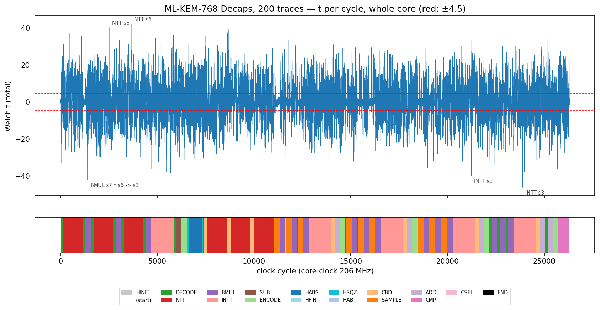
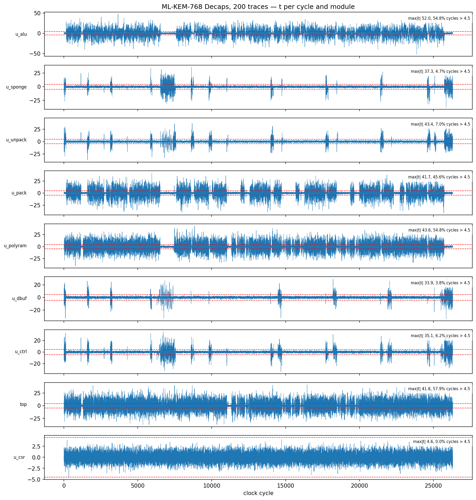
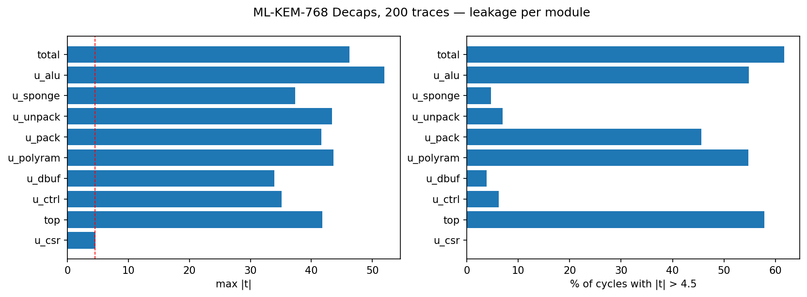
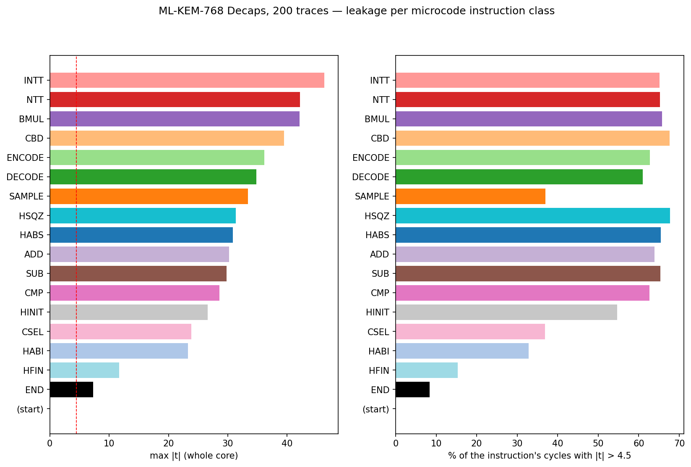
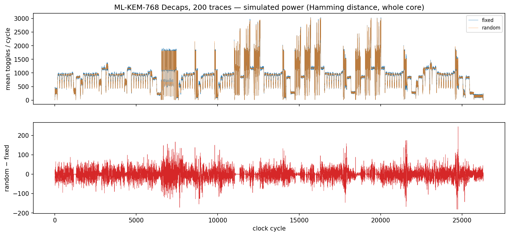
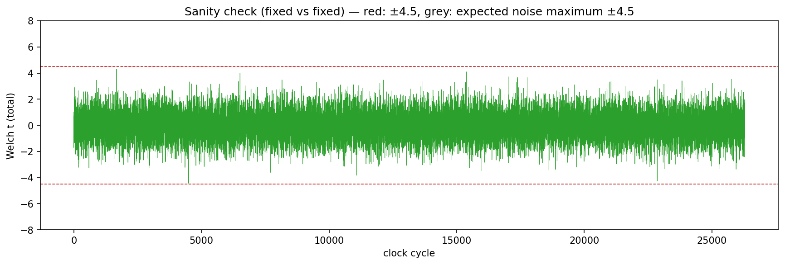
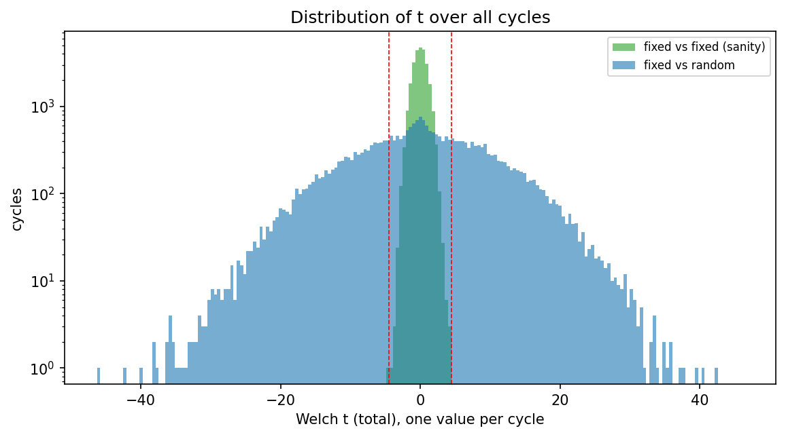

# 仿真级 TVLA 报告：ML-KEM-768 Decaps

**结论：检测到一阶泄漏（核心未做掩码，属于预期）**

**流程自检（fixed vs fixed）：通过**　max|t| = 4.45，纯噪声下的预期最大值约 4.51。

| 项目 | 值 |
| ---- | -- |
| 时间 | 2026-10-06 13:24:20 |
| 运算 | decaps |
| trace 数 | 200（fixed 100，random 100） |
| 每条 trace 周期数 | 26298–26298（127.7 µs @ 206 MHz） |
| 噪声 σ | 1.0 次翻转 |
| 功耗模型 | 每周期翻转比特数（汉明距离），核心内全部信号，按模块分别统计 |
| 阈值 | \|t\| > 4.5 |
| fixed 组 seed | `c0d04ba0fd08f064417e8f877619b0fb…` |
| 源码版本 | git d86c824 |

## 1. 整个核心的 t 曲线

上图：每个周期的 Welch t 值，红色虚线为 ±4.5。下方色带表示该周期正在执行的微码指令类别。

## 2. 各模块

| 模块 | 说明 | max\|t\| | 出现周期 | 超阈值周期占比 | 首个超阈值周期 | max 处的指令 |
| ---- | ---- | -------: | -------: | -------------: | -------------: | ------------ |
| total | 整个核心 | 46.3 | 23870 | 61.70% | 8 | INTT s3 |
| u_alu | 多项式 ALU（NTT/INTT、BMUL、加减） | 52.0 | 23870 | 54.82% | 153 | INTT s3 |
| u_sponge | Keccak sponge | 37.3 | 25863 | 4.69% | 10 | CMP OUT+256, IN+2400 len=1088 |
| u_unpack | SampleNTT、CBD、Decode / Decompress | 43.4 | 24738 | 6.98% | 10 | CBD2 -> s5 |
| u_pack | Compress、Encode | 41.7 | 5947 | 45.57% | 153 | DECODE d=4 IN+3360 -> s6 |
| u_polyram | 多项式 RAM 端口 | 43.6 | 8834 | 54.80% | 18 | NTT s1 |
| u_dbuf | 数据缓冲端口 | 33.9 | 25861 | 3.80% | 8 | CMP OUT+256, IN+2400 len=1088 |
| u_ctrl | 微码控制器 | 35.1 | 6725 | 6.23% | 9 | HABS IN+2400 len=1088 |
| top | 顶层连线 | 41.8 | 16452 | 57.90% | 9 | BMUL s4 * s2 -> s3 (acc) |
| u_csr | AXI 寄存器 | 4.6 | 331 | 0.00% | 331 | NTT s6 |

同一根信号如果连接两个模块，会同时计入这两个模块，所以各模块之和不等于 total。

## 3. 按微码指令

| 指令类别 | 周期数 | max\|t\| | 超阈值周期占比 |
| -------- | -----: | -------: | -------------: |
| INTT | 5710 | 46.3 | 65.1% |
| NTT | 5994 | 42.2 | 65.2% |
| BMUL | 4215 | 42.1 | 65.7% |
| CBD | 1295 | 39.5 | 67.6% |
| ENCODE | 1350 | 36.1 | 62.7% |
| DECODE | 1573 | 34.8 | 61.0% |
| SAMPLE | 2710 | 33.4 | 37.0% |
| HSQZ | 124 | 31.4 | 67.7% |
| HABS | 956 | 30.9 | 65.5% |
| ADD | 1325 | 30.2 | 63.9% |
| SUB | 265 | 29.8 | 65.3% |
| CMP | 551 | 28.6 | 62.6% |
| HINIT | 75 | 26.6 | 54.7% |
| CSEL | 19 | 23.9 | 36.8% |
| HABI | 64 | 23.3 | 32.8% |
| HFIN | 72 | 11.7 | 15.3% |
| END | 12 | 7.3 | 8.3% |
| (start) | 1 | 0.9 | 0.0% |

泄漏最强的 15 条指令（按 max|t|，total）：

| max\|t\| | 周期范围 | pc | 指令 | 超阈值占比 |
| -------: | -------- | -: | ---- | ---------: |
| 46.3 | 23432–24573 | 363 | `INTT s3` | 63% |
| 42.2 | 3279–4277 | 244 | `NTT s6` | 66% |
| 42.1 | 1289–1569 | 238 | `BMUL s7 * s6 -> s3` | 64% |
| 40.2 | 1713–2711 | 240 | `NTT s6` | 66% |
| 39.9 | 20271–21412 | 349 | `INTT s3` | 65% |
| 39.5 | 8616–8800 | 271 | `CBD2 -> s1` | 63% |
| 38.3 | 4702–5843 | 247 | `INTT s3` | 68% |
| 37.3 | 147–1145 | 236 | `NTT s6` | 68% |
| 36.2 | 4421–4701 | 246 | `BMUL s7 * s6 -> s3 (acc)` | 66% |
| 36.1 | 25459–25728 | 372 | `ENCODE d=4 s3 -> OUT+1216` | 63% |
| 36.0 | 12842–13983 | 297 | `INTT s3` | 65% |
| 35.8 | 7405–7589 | 265 | `CBD2 -> s0` | 68% |
| 35.8 | 18766–19046 | 336 | `BMUL s4 * s0 -> s3` | 66% |
| 35.7 | 16278–16558 | 322 | `BMUL s4 * s2 -> s3 (acc)` | 68% |
| 34.8 | 25051–25193 | 370 | `DECODE d=1 0x1c60 -> s5` | 66% |

## 4. 平均功耗曲线

上：两组的平均翻转数（功耗形状，可以看出各运算阶段）；下：两组之差。

## 5. 流程自检：fixed vs fixed

两组用完全相同的输入，理论上没有任何泄漏。由于每条 trace 有 26293 个采样点（多重检验），纯噪声下 max|t| 的预期值约为 √(2 ln N) = 4.51，偶尔超过 4.5 是正常的；判定为通过的条件是 max|t| < 7 且超阈值周期占比 < 0.1%。

| 模块 | max\|t\| | 超阈值周期数 |
| ---- | -------: | -----------: |
| total | 4.45 | 0 |
| u_alu | 4.66 | 1 |
| u_sponge | 4.10 | 0 |
| u_unpack | 4.63 | 1 |
| u_pack | 4.40 | 0 |
| u_polyram | 4.39 | 0 |
| u_dbuf | 4.56 | 1 |
| u_ctrl | 4.53 | 1 |
| top | 4.03 | 0 |
| u_csr | 3.94 | 0 |

## 文件

- `figures/`：上面的图（PNG）
- `raw/main/tvla_t.csv`：每个周期一行：cycle, pc, instruction, t_total, t_<模块>…
- `raw/main/tvla_mean.csv`：每个周期两组的平均翻转数
- `raw/main/vectors.csv`：本次使用的全部输入（index, class, input_hex）
- `raw/main/vcd/`：每组保留的 VCD 波形（用 GTKWave / Surfer 打开）
- `raw/main/summary.txt`、`raw/main/engine.log`：引擎原始输出
- `raw/sanity/`：fixed-vs-fixed 的同样文件
- `analysis.json`：本报告用到的统计数据

说明见 `docs/TVLA_SIM.md`。仿真的汉明距离模型不包含布线电容、毛刺和耦合，真实芯片上的泄漏只会更多。这个核心没有做掩码，检测到泄漏是预期结果。
