# 仿真级 TVLA 报告：ML-KEM-768 Decaps

**结论：检测到一阶泄漏（核心未做掩码，属于预期）**

**流程自检（fixed vs fixed）：通过**　max|t| = 4.43，纯噪声下的预期最大值约 4.51。

| 项目 | 值 |
| ---- | -- |
| 时间 | 2026-10-06 13:57:41（重新绘图） |
| 运算 | decaps |
| trace 数 | 200（fixed 100，random 100） |
| 每条 trace 周期数 | 26291–26291（127.6 µs @ 206 MHz） |
| 噪声 σ | 1.0 次翻转 |
| 功耗模型 | 汉明距离（HD）：每周期翻转的比特数，核心内全部信号，按模块 / 运算式分别统计 |
| 阈值 | \|t\| > 4.5 |
| fixed 组 seed | `070adbaa69fadaad6c6aa26d9947eedb…` |
| 源码版本 | git 5e859d9 |

## 1. 解密中三个运算式的泄漏对比（P1 / P2 / P3）

解密 m' = Compress₁(v − INTT(ŝᵀ∘û)) 中的三个中间运算式：

| 点 | 运算式 | 含义 | 截取的指令窗口 |
| -- | ------ | ---- | -------------- |
| P1 | ŝᵀ∘û | 未约减的乘积（模 q 之前） | 解密的 3 条 BMUL s7 * s6（i = 0, 1, 2） |
| P2 | (ŝᵀ∘û) mod q | Barrett 约减后的结果 | 同 P1 |
| P3 | v − (sᵀu mod q) | 解密的减法 | SUB s6 - s3 -> s3（s6 = v，s3 = INTT 结果） |

**结论：泄漏最强的是 P2（(ŝᵀ∘û) mod q）：数据相关功耗的标准差 σ_data = 8.5 次翻转（窗口内 RMS），是 P1 的 1.84 倍、P3 的 2.40 倍。三个运算式在 fixed-vs-random TVLA 中都明显泄漏（max|t| 分别为 P1 28.4、P2 36.2、P3 24.0，均远超 4.5）。**

### 方法

**功耗模型：汉明距离（HD）。** 仿真没有真实功耗，用 RTL 波形（VCD）计算：寄存器在时钟沿从旧值 x 变成新值 x′ 时翻转的比特数 HD(x, x′) = HW(x ⊕ x′)，它正比于 CMOS 寄存器和连线的动态功耗，是硬件实现的标准模型（汉明重量模型可用 `--model hw` 切换，适合软件实现）。

**拼接方法（三个层次）：**

1. **比特拼接。** 每个 RAM 字是两个 12 bit 系数拼成的 24 bit 字 {f[2w+1], f[2w]}；两个乘法器（u_mul0、u_mul1）的同名寄存器和一个运算式的所有流水线副本，也都当作一个长比特向量 X_P。HD 对比特可加，所以 HD(X_P) = Σ_寄存器 HD(寄存器)。每个点由哪些寄存器组成见下面的分项表。
2. **周期样本。** 点 P 在第 c 个时钟周期的样本为 L_P(c) = Σ_{r∈P} HD(r(c−1), r(c)) + N(0, σ²)，σ = 1.0；每个周期一个样本，相当于一个只对准这些寄存器的理想探头。
3. **时间拼接。** 同一组寄存器在其他指令中保存的是别的值（例如 NTT 里乘法器算 ζ·b，下图中阴影以外的部分），所以只截取真正计算该运算式的周期：P1、P2 取解密的 3 条 `BMUL s7 * s6`（i = 0, 1, 2，每条 281 个周期），按时间顺序首尾相接，得到 843 个采样点的 trace；P3 取 `SUB s6 - s3 -> s3` 的 265 个周期。核心是常数时间的（每条 trace 都是 26291 个周期），窗口在所有 trace 中位于同一周期位置，不需要额外对齐；所有统计量都在拼接后的 trace 上逐点计算。

流水线中同一周期的不同寄存器保存的是不同系数字的值（BMUL 每 2 个周期读一个字，乘积在读后第 5 拍进入 DSP 的 M 寄存器，结果在第 21 拍写回），所以一个样本是几个字的叠加，这与真实功耗一致。fixed 组的密文固定（û、v 固定），random 组每条 trace 一个新的合法密文；两组的私钥 ŝ 相同。

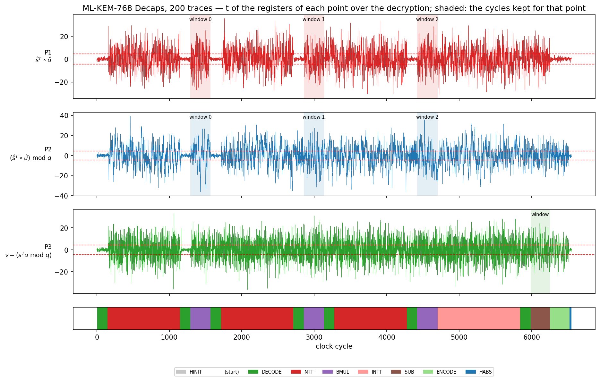

**两个指标：**

- **TVLA（检测）**：fixed vs random 的 Welch t，|t| > 4.5 即判定该点泄漏。
- **σ_data（泄漏强度，用于排序）**：random 组每个采样点的标准差去掉所加噪声，σ_data(c) = √(Var_random(L_P(c)) − σ²)。仿真本身没有噪声，random 组的方差完全来自数据（随机密文的 û、v），也就是 SNR 的分子（信号）。σ_data 越大，在同样的测量噪声下越容易被 TVLA 检出、被 CPA 攻击（相关系数 ρ = √(SNR / (1 + SNR))）。它只用 random 组，不依赖 fixed 组选了哪个输入。

**为什么不直接用 max|t| 排序：** 仿真没有噪声时，fixed 组的方差只有所加的噪声 σ²，t ≈ √(N/2)·z，其中 z = (x_fixed − μ_random)/σ_data 只表示这一个固定输入在随机分布中偏离多远，与该运算式泄漏多少无关。所以任何与数据有关的寄存器组，平均 |t| 都约为 √(N/2)·0.8 = 8.0（本次 P1/P2/P3 为 7.8 / 8.3 / 7.7），max|t| 的先后会随固定输入改变（换 fixed 输入重跑就能看到）。只有当噪声远大于 σ_data 时，t ≈ √(N/4)·z·σ_data/σ 才与 σ_data 成正比，所以按 σ_data 排序就是“真实测量噪声下 TVLA 的排序”。

### 结果

| 点 | 运算式 | 比特数 | 采样点数 | **σ_data RMS** | σ_data 最大（周期） | σ²/bit | TVLA max\|t\| | 平均 \|t\| | 超阈值样本占比 |
| -- | ------ | -----: | -------: | -------------: | ------------------- | -----: | ------------: | ---------: | -------------: |
| P2 | (ŝᵀ∘û) mod q | 300 | 843 | **8.5** | 10.8（2997） | 0.240 | 36.2 | 8.3 | 64.8% |
| P1 | ŝᵀ∘û | 96 | 843 | **4.6** | 5.9（1410） | 0.222 | 28.4 | 7.8 | 65.5% |
| P3 | v − (sᵀu mod q) | 48 | 265 | **3.5** | 4.2（6239） | 0.261 | 24.0 | 7.7 | 67.9% |

按 σ_data 从大到小排列；σ_data 的单位是次翻转 / 周期。σ²/bit = 窗口内平均方差 ÷ 比特数，即每个寄存器比特贡献的数据相关方差；每个比特以 1/2 概率随机翻转时为 0.25，这是上限的量级。

按每比特看，P1/P2/P3 的 σ²/bit 为 0.222 / 0.240 / 0.261，相差不到 1.5 倍、都接近随机数据的 0.25：每个寄存器比特泄漏得差不多，排序主要取决于硬件里保存该运算式的寄存器比特数（P2 包括 Barrett 输出、Karatsuba 基乘的中间项及其延迟链、累加器，共 300 bit）。

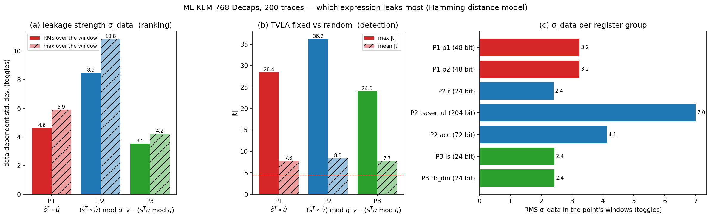

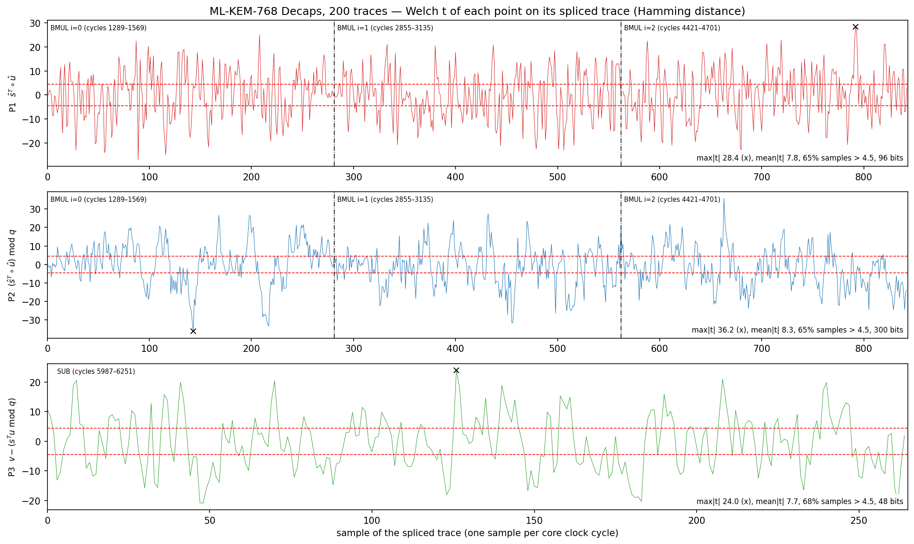

上图：每个点在拼接 trace 上的 Welch t（× 为 max|t|，点划线为窗口之间的拼接处）。

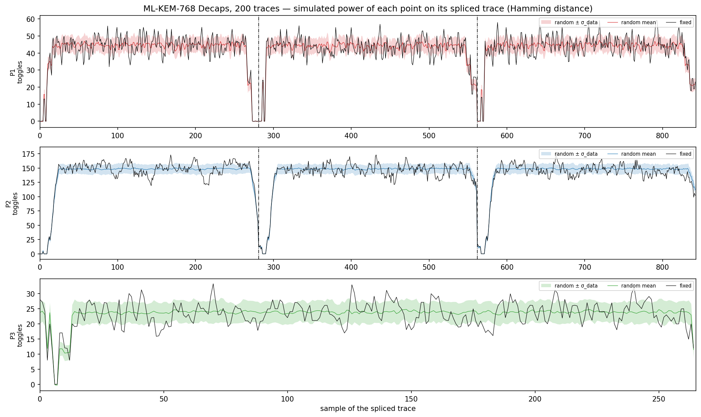

上图：拼接 trace 上各点的功耗（翻转数）。黑线：fixed 组；彩色线和阴影：random 组的均值 ± σ_data。阴影越宽，该运算式的功耗随数据变化越大，即泄漏越强。

分项（每个点里各组寄存器单独统计）：

| 点 | 寄存器组 | 信号 | 比特数 | σ_data RMS | σ²/bit | TVLA max\|t\| | 说明 |
| -- | -------- | ---- | -----: | ---------: | -----: | ------------: | ---- |
| P1 | p1 | `u_alu.u_mul0.p1, u_alu.u_mul1.p1` | 48 | 3.2 | 0.218 | 26.5 | 两个乘法器 DSP 的 M 寄存器：a·b，24 bit。mul0 交替保存 â0·b̂0 与 (â0+â1)(b̂0+b̂1)，mul1 交替保存 â1·b̂1 与 (â1b̂1 mod q)·γ |
| P1 | p2 | `u_alu.u_mul0.p2, u_alu.u_mul1.p2` | 48 | 3.2 | 0.218 | 27.7 | DSP 的 P 寄存器：同一乘积晚一拍 |
| P2 | r | `u_alu.u_mul0.r, u_alu.u_mul1.r` | 24 | 2.4 | 0.240 | 29.1 | Barrett 输出 r = a·b mod q（12 bit × 2） |
| P2 | basemul | `u_alu.p00, u_alu.p11, u_alu.p11d, u_alu.p00d*, u_alu.s1, u_alu.h1, u_alu.h1d*, u_alu.h0` | 204 | 7.0 | 0.240 | 41.4 | 基乘组合（全部已模 q）：a0b0、a1b1 及其延迟链，s1、h1 = a0b1+a1b0，h0 = a0b0+a1b1γ |
| P2 | acc | `u_alu.wb, u_alu.wbd, u_alu.rb_din` | 72 | 4.1 | 0.237 | 34.8 | 累加结果 Σᵢ ŝᵢ∘ûᵢ mod q（每个字 = 两个系数拼接的 24 bit）及 RAM 写回数据 |
| P3 | ls | `u_alu.ls` | 24 | 2.4 | 0.244 | 24.6 | 减法结果寄存器 ls = msub(v, w)，两个系数拼接 24 bit（读后第 4 拍） |
| P3 | rb_din | `u_alu.rb_din` | 24 | 2.4 | 0.246 | 24.9 | RAM 写回数据，ls 的下一拍 |

单个寄存器组中泄漏最强的是 P2 的 basemul（σ_data = 7.0），最弱的是 P2 的 r（σ_data = 2.4）。

比较时注意：σ_data 随参与翻转的比特数增大（独立比特时约按 √比特数），所以“点”这一行比较的是该运算式在硬件里的全部寄存器（真实芯片上泄漏的就是这些），分项表可以按单个寄存器组比较（例如 P1 的 p1、P2 的 r、P3 的 ls）。

## 2. 整个核心的 t 曲线

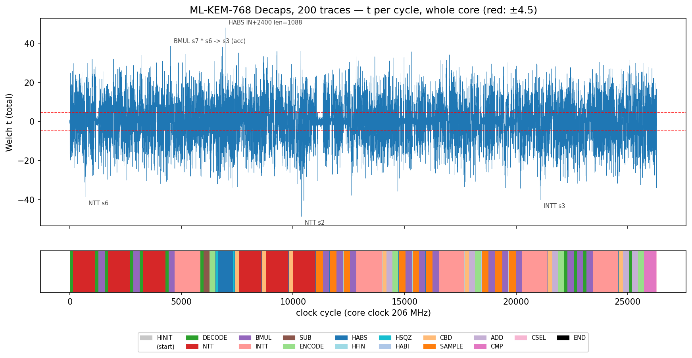

上图：每个周期的 Welch t 值，红色虚线为 ±4.5。下方色带表示该周期正在执行的微码指令类别。

## 3. 各模块

| 模块 | 说明 | max\|t\| | 出现周期 | 超阈值周期占比 | 首个超阈值周期 | max 处的指令 |
| ---- | ---- | -------: | -------: | -------------: | -------------: | ------------ |
| total | 整个核心 | 48.7 | 10370 | 61.79% | 9 | NTT s2 |
| u_alu | 多项式 ALU（NTT/INTT、BMUL、加减） | 47.3 | 10370 | 55.01% | 153 | NTT s2 |
| u_sponge | Keccak sponge | 47.9 | 6964 | 4.65% | 12 | HABS IN+2400 len=1088 |
| u_unpack | SampleNTT、CBD、Decode / Decompress | 34.6 | 7561 | 7.03% | 11 | CBD2 -> s0 |
| u_pack | Compress、Encode | 38.7 | 8186 | 45.20% | 153 | NTT s0 |
| u_polyram | 多项式 RAM 端口 | 50.8 | 25149 | 54.14% | 18 | DECODE d=1 0x1c60 -> s5 |
| u_dbuf | 数据缓冲端口 | 45.9 | 26289 | 3.68% | 9 | CSEL flag ? 0x1c80 : 0x1c00 -> OUT+0 len=32 |
| u_ctrl | 微码控制器 | 35.5 | 1640 | 6.09% | 10 | DECODE d=10 IN+2720 -> s6 |
| top | 顶层连线 | 41.1 | 24839 | 57.39% | 10 | ADD s3 + s5 -> s3 |
| u_csr | AXI 寄存器 | 4.1 | 16872 | 0.00% | — | INTT s3 |

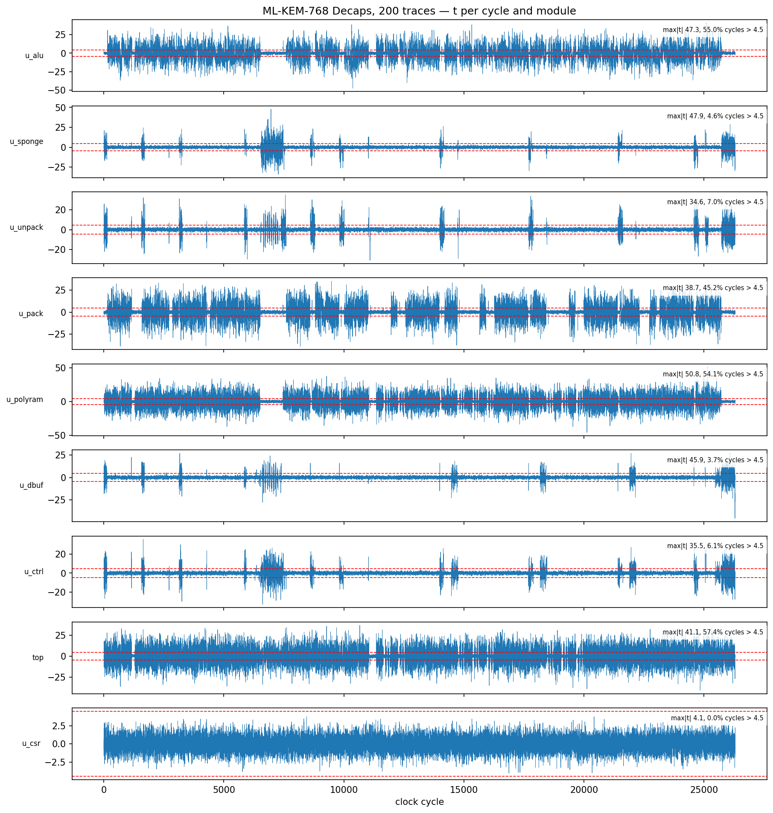

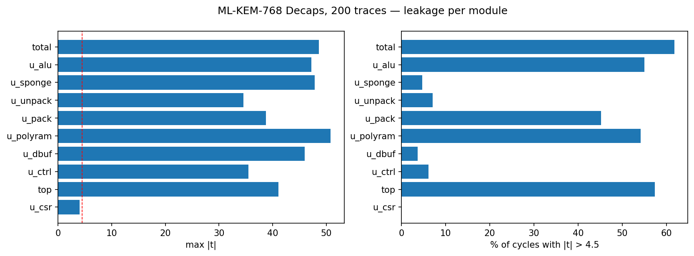

同一根信号如果连接两个模块，会同时计入这两个模块，所以各模块之和不等于 total。

## 4. 按微码指令

| 指令类别 | 周期数 | max\|t\| | 超阈值周期占比 |
| -------- | -----: | -------: | -------------: |
| NTT | 5994 | 48.7 | 66.2% |
| HABS | 956 | 48.0 | 63.2% |
| INTT | 5710 | 40.0 | 65.2% |
| BMUL | 4215 | 38.5 | 65.3% |
| ENCODE | 1350 | 35.7 | 62.7% |
| CBD | 1295 | 35.1 | 68.4% |
| CSEL | 19 | 33.9 | 57.9% |
| DECODE | 1573 | 33.9 | 61.5% |
| HINIT | 75 | 33.5 | 49.3% |
| SAMPLE | 2703 | 32.8 | 35.0% |
| HSQZ | 124 | 32.0 | 69.4% |
| ADD | 1325 | 31.0 | 65.1% |
| CMP | 551 | 27.8 | 66.1% |
| SUB | 265 | 21.8 | 64.2% |
| HABI | 64 | 17.9 | 35.9% |
| HFIN | 72 | 15.3 | 8.3% |
| END | 12 | 2.2 | 0.0% |
| (start) | 1 | 0.8 | 0.0% |

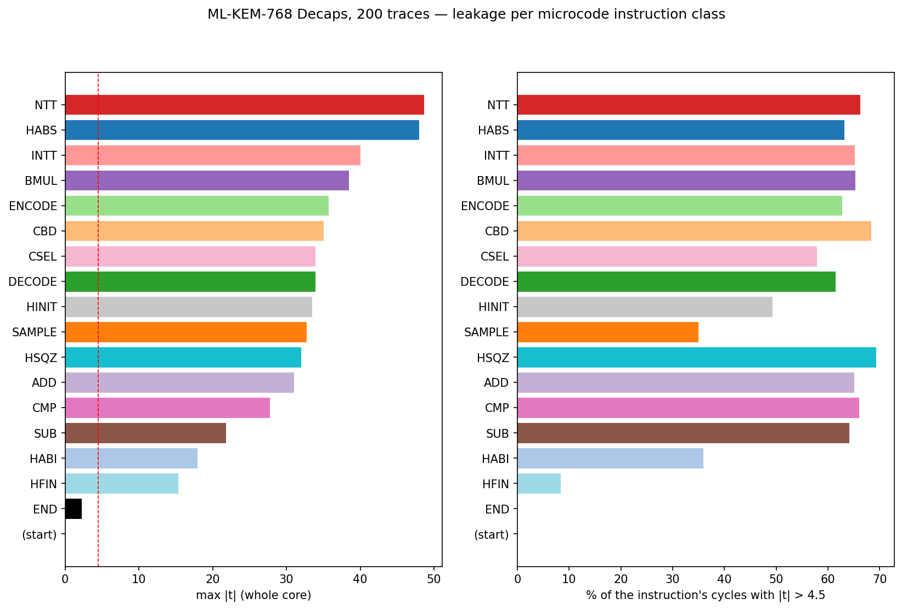

泄漏最强的 15 条指令（按 max|t|，total）：

| max\|t\| | 周期范围 | pc | 指令 | 超阈值占比 |
| -------: | -------- | -: | ---- | ---------: |
| 48.7 | 10012–11010 | 278 | `NTT s2` | 67% |
| 48.0 | 6645–7315 | 258 | `HABS IN+2400 len=1088` | 66% |
| 40.0 | 20264–21405 | 349 | `INTT s3` | 64% |
| 38.6 | 147–1145 | 236 | `NTT s6` | 68% |
| 38.5 | 4421–4701 | 246 | `BMUL s7 * s6 -> s3 (acc)` | 66% |
| 37.9 | 12557–12837 | 296 | `BMUL s4 * s2 -> s3 (acc)` | 68% |
| 37.3 | 23425–24566 | 363 | `INTT s3` | 67% |
| 35.9 | 1713–2711 | 240 | `NTT s6` | 64% |
| 35.9 | 8801–9799 | 272 | `NTT s1` | 68% |
| 35.7 | 14457–14726 | 304 | `ENCODE d=10 s3 -> OUT+256` | 65% |
| 35.7 | 15047–15327 | 310 | `BMUL s4 * s0 -> s3` | 63% |
| 35.1 | 7405–7589 | 265 | `CBD2 -> s0` | 76% |
| 34.5 | 4702–5843 | 247 | `INTT s3` | 65% |
| 34.2 | 19983–20263 | 348 | `BMUL s4 * s2 -> s3 (acc)` | 65% |
| 34.1 | 16538–17679 | 323 | `INTT s3` | 65% |

## 5. 平均功耗曲线

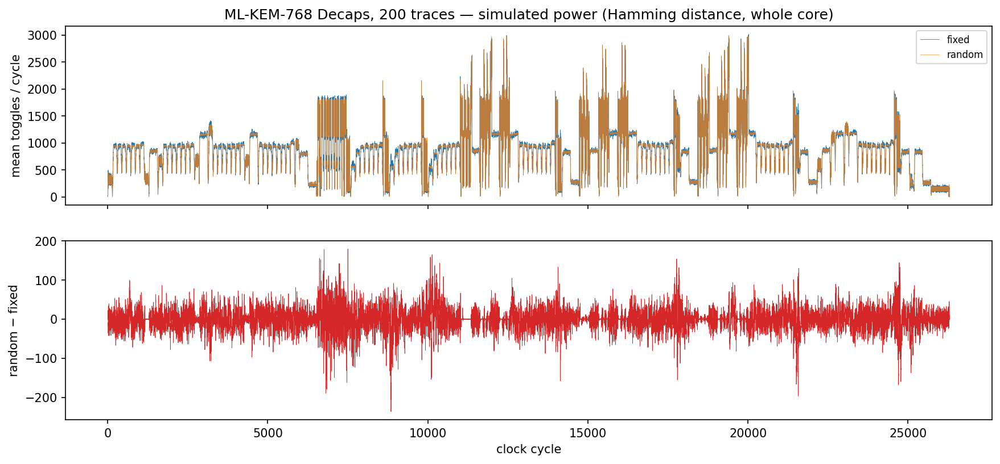

上：两组的平均翻转数（功耗形状，可以看出各运算阶段）；下：两组之差。

## 6. 流程自检：fixed vs fixed

两组用完全相同的输入，理论上没有任何泄漏。由于每条 trace 有 26298 个采样点（多重检验），纯噪声下 max|t| 的预期值约为 √(2 ln N) = 4.51，偶尔超过 4.5 是正常的；判定为通过的条件是 max|t| < 7 且超阈值周期占比 < 0.1%。

| 模块 | max\|t\| | 超阈值周期数 |
| ---- | -------: | -----------: |
| total | 4.43 | 0 |
| u_alu | 4.66 | 1 |
| u_sponge | 4.22 | 0 |
| u_unpack | 3.86 | 0 |
| u_pack | 4.29 | 0 |
| u_polyram | 4.72 | 1 |
| u_dbuf | 4.43 | 0 |
| u_ctrl | 4.57 | 1 |
| top | 3.96 | 0 |
| u_csr | 4.10 | 0 |

三个运算式在各自拼接窗口上的自检：

| 点 | 采样点数 | max\|t\| | 纯噪声预期最大值 | 超阈值样本数 | σ_data RMS（应接近 0） |
| -- | -------: | -------: | ---------------: | -----------: | ---------------------: |
| P1 | 843 | 4.21 | 3.67 | 0 | 0.24 |
| P2 | 843 | 3.27 | 3.67 | 0 | 0.25 |
| P3 | 265 | 3.22 | 3.34 | 0 | 0.23 |

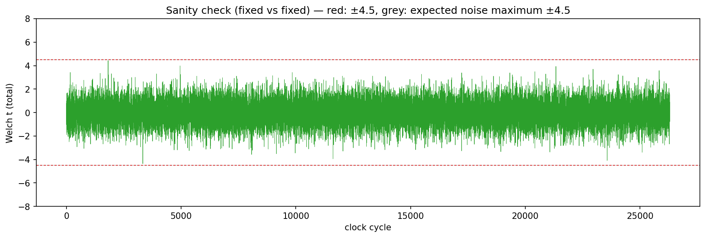

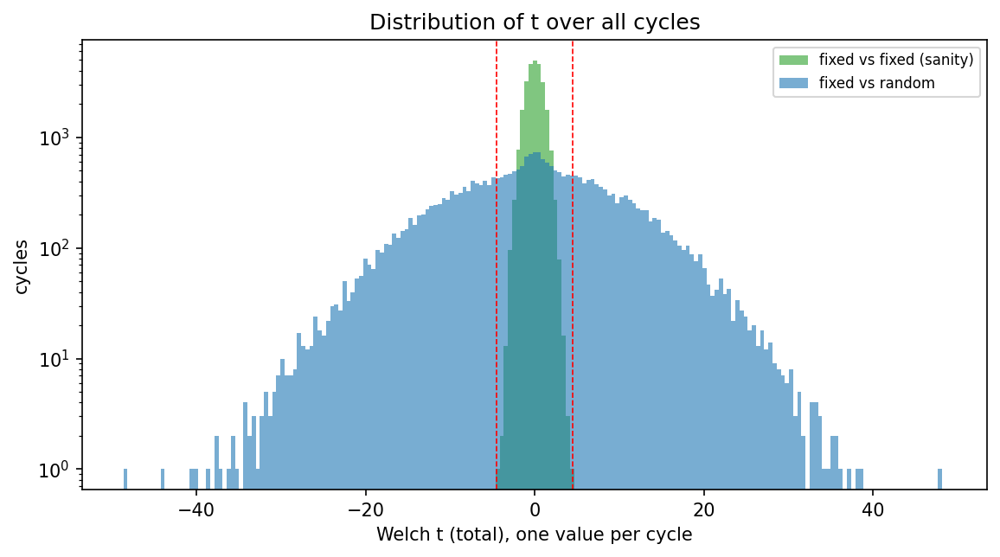

## 文件

- `figures/`：上面的图（PNG）
- `raw/main/tvla_t.csv`：每个周期一行：cycle, pc, instruction, t_total, t_<模块>…, t_P1…（运算式的寄存器组）
- `raw/main/tvla_mean.csv`：每个周期两组的平均样本值（total 与各运算式）
- `raw/main/vectors.csv`：本次使用的全部输入（index, class, input_hex）
- `raw/main/vcd/`：每组保留的 VCD 波形（用 GTKWave / Surfer 打开）
- `raw/main/summary.txt`、`raw/main/engine.log`：引擎原始输出
- `raw/sanity/`：fixed-vs-fixed 的同样文件
- `analysis.json`：本报告用到的统计数据

说明见 `docs/TVLA_SIM.md`。仿真的汉明距离 / 重量模型不包含布线电容、毛刺和耦合，真实芯片上的泄漏只会更多。这个核心没有做掩码，检测到泄漏是预期结果。
